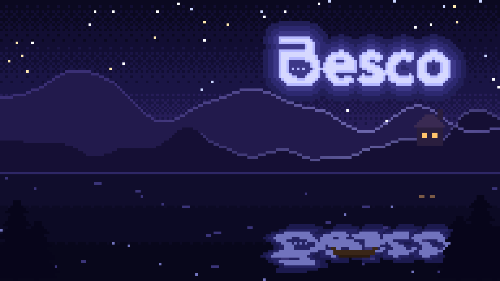
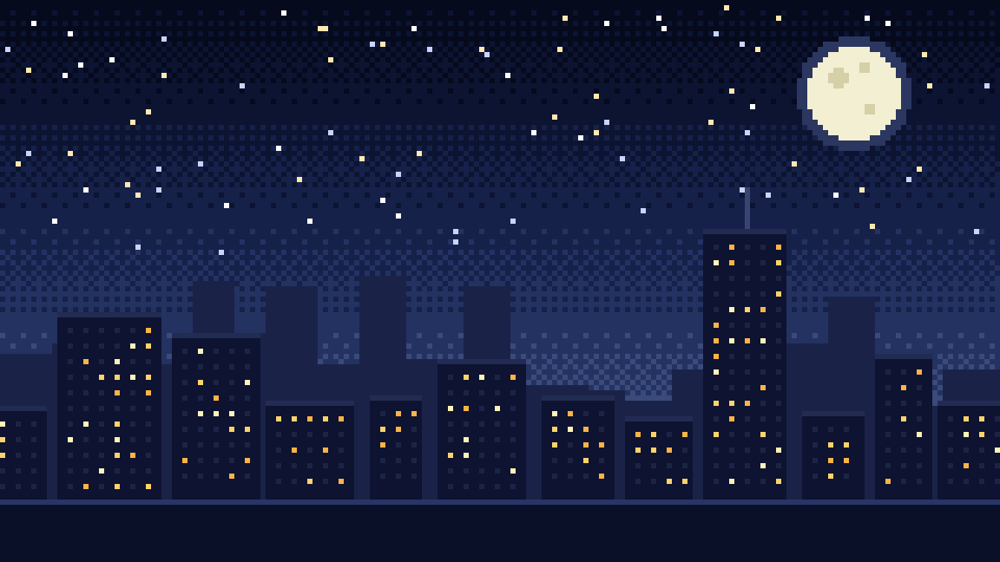
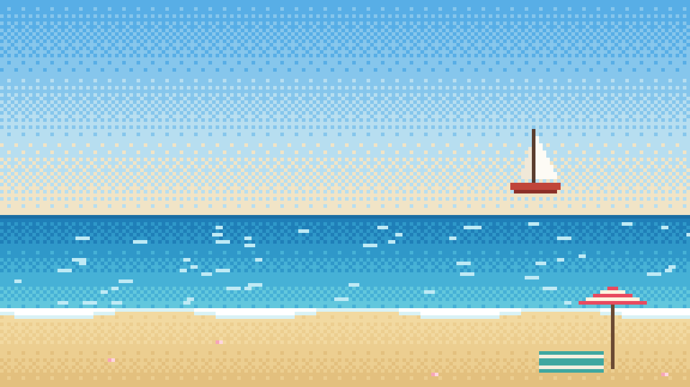
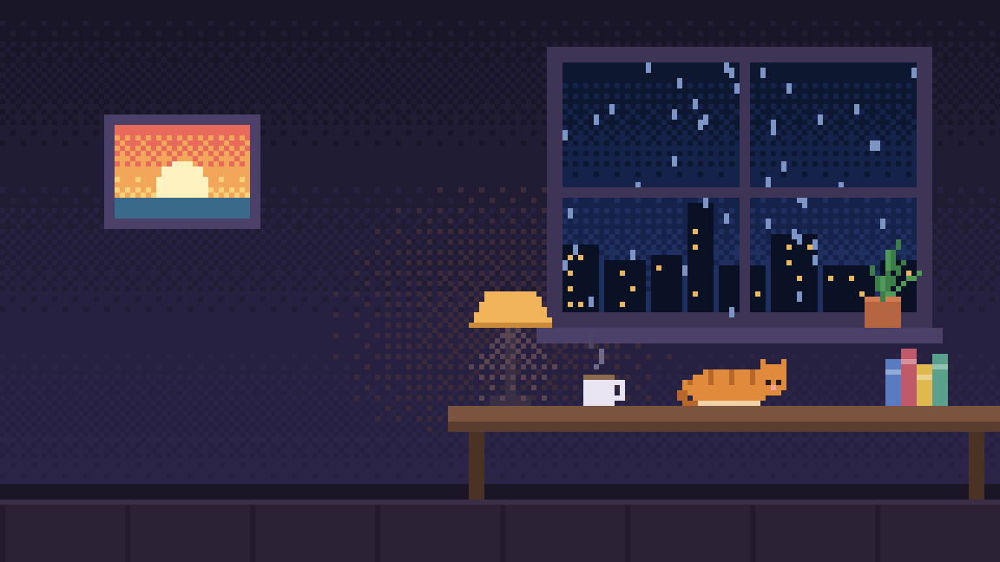
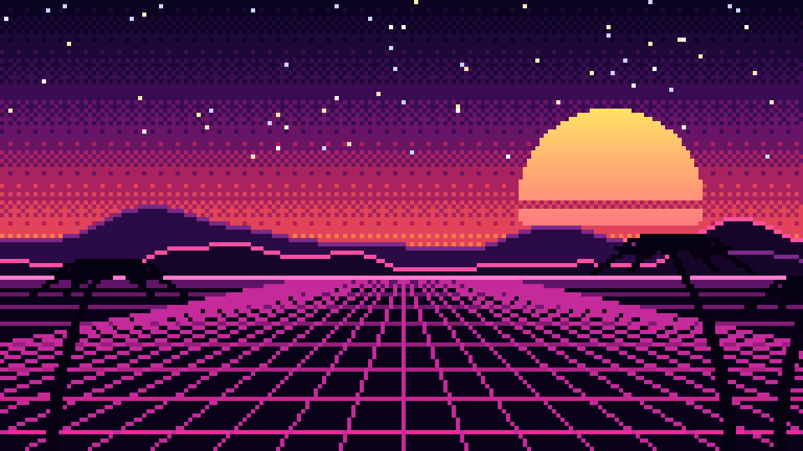
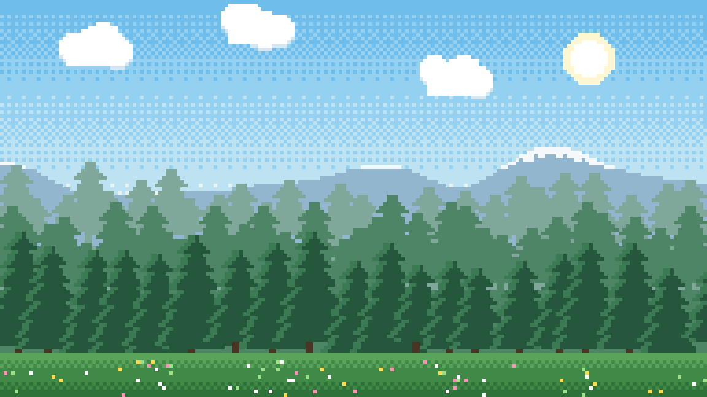
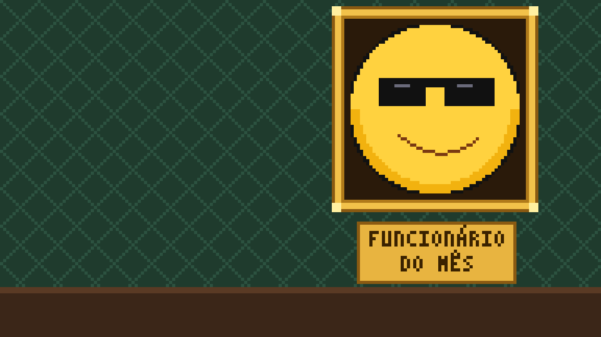

# Besco Temas (pixel-temas)

Temas animados para o fundo da janela do Claude Desktop, feitos pela Besco. São 30 temas com o logo da Besco pulsando, em vários estilos, mais cenas em pixel art e temas de zoeira em que a foto de alguém quica pela tela, cai do céu ou vira "funcionário do mês".



## O que você precisa

1. **Claude Desktop** atualizado, no Mac ou no Windows. O tema aparece atrás da conversa na aba Code.
2. **Claude Code**, que já vem junto com o Claude Desktop. Para instalar pelo terminal, o comando `claude` precisa estar disponível.
3. **Acesso a este repositório.** Ele é privado: peça para alguém da Besco te convidar no GitHub e aceite o convite pelo e-mail ou em github.com.
4. **O GitHub configurado no seu computador.** A instalação baixa o repositório sem pedir senha, então o computador já precisa estar logado no GitHub. O jeito mais simples é instalar o [GitHub CLI](https://cli.github.com) e rodar, uma vez:

```bash
gh auth login
```

```bash
gh auth setup-git
```

Se você já usa `git clone` em repositórios privados da Besco sem digitar senha, pode pular este passo.

## Instalar

Escolha um dos três jeitos.

**No terminal, dentro de uma sessão do Claude Code** (rode `claude` e digite):

```
/plugin install pixel-temas --marketplace besco-ai/besco-temas
```

Ele pergunta `Add marketplace?`. Responda `y`, depois escolha o escopo com Enter (o primeiro, "user", vale para todas as suas sessões). No fim aparece `Installed pixel-temas. Plugin is now active.`

**Direto no terminal, fora do Claude Code:**

```bash
claude plugin install pixel-temas --marketplace besco-ai/besco-temas
```

**No Claude Desktop, sem terminal:** clique no **+** ao lado da caixa de mensagem, depois em **Plugins**, **Add marketplace**, digite `besco-ai/besco-temas` e confirme. Em seguida clique em **Add plugin** e escolha **pixel-temas**.

Depois de instalar, abra uma sessão nova na aba Code do Claude Desktop.

## Usar

Digite na caixa de mensagem do Claude Desktop:

| Comando | O que faz |
| --- | --- |
| `/pixel` | Lista todos os temas |
| `/pixel besco` | Aplica um tema pelo nome |
| `/pixel aleatorio` | Sorteia um tema |
| `/pixel off` | Tira o tema |

O tema escolhido vale para todas as sessões até você trocar. Ele aparece a partir da próxima mensagem que você mandar.

## Pack Besco: 30 temas animados

Todos com o logo da Besco pulsando, em estilos diferentes: vetor, neon, gradiente, linha, papel, holograma e pixel art. Para ver todos animados, abra [`previas/galeria.html`](previas/galeria.html) no navegador.

| Comando | Tema | Janela |
| --- | --- | --- |
| `/pixel besco` | Lago à noite com o logo no céu e refletido na água (pixel) | escura |
| `/pixel besco-pixel-cidade` | Cidade com um outdoor da Besco (pixel) | escura |
| `/pixel besco-aurora` | Aurora boreal sobre colinas de neve | escura |
| `/pixel besco-galaxia` | Galáxia em espiral girando | escura |
| `/pixel besco-orbita` | Planetas em órbita do logo | escura |
| `/pixel besco-foguete` | Foguete dando voltas no planeta Besco | escura |
| `/pixel besco-constelacao` | O logo desenhado com estrelas | escura |
| `/pixel besco-neon` | Letreiro de neon rosa numa parede de tijolos | escura |
| `/pixel besco-synthwave` | Pôr do sol neon com grade correndo | escura |
| `/pixel besco-vaporwave` | Vaporwave rosa e ciano, logo tremendo em cores | escura |
| `/pixel besco-codigo` | Chuva de blocos de código | escura |
| `/pixel besco-terminal` | Terminal com código sendo digitado | escura |
| `/pixel besco-holograma` | Holograma saindo de um projetor | escura |
| `/pixel besco-som` | Equalizador de música | escura |
| `/pixel besco-radar` | Radar girando | escura |
| `/pixel besco-planta` | Planta técnica com o logo sendo desenhado | escura |
| `/pixel besco-contorno` | O logo se desenhando em linha neon | escura |
| `/pixel besco-chuva-neon` | Cidade na chuva com reflexo no chão | escura |
| `/pixel besco-ondulacao` | Ondas circulares num lago escuro | escura |
| `/pixel besco-por-do-sol` | Montanhas em camadas no pôr do sol | escura |
| `/pixel besco-gradiente` | Manchas de cor escura se movendo | escura |
| `/pixel besco-lava` | Lâmpada de lava | escura |
| `/pixel besco-minimal-escuro` | Fundo preto com anéis saindo do logo | escura |
| `/pixel besco-oceano` | Mar em camadas ao amanhecer | clara |
| `/pixel besco-nuvens` | Céu com nuvens e balões | clara |
| `/pixel besco-bolhas` | Manchas pastel se movendo | clara |
| `/pixel besco-confete` | Confete caindo | clara |
| `/pixel besco-papel` | Papel recortado em camadas | clara |
| `/pixel besco-isometrico` | Cubos isométricos flutuando | clara |
| `/pixel besco-minimal-claro` | Fundo claro minimalista | clara |

## Outros temas

| Nome | Tipo | Janela | O que tem |
| --- | --- | --- | --- |
| `cidade` | animado | escura | Cidade de noite com janelas acendendo, estrelas piscando e um trem cruzando a ponte |
| `praia` | animado | clara | Ondas, barco balançando, nuvens andando e gaivotas |
| `chuva` | animado | escura | Quarto lo-fi com chuva na janela, gato dormindo e café soltando vapor |
| `synthwave` | estático | escura | Pôr do sol retrô com grade neon e palmeiras |
| `floresta` | estático | clara | Pinheiros, montanhas nevadas e flores |
| `dvd` | zoeira | escura | Uma cara quicando pela tela, estilo protetor de tela de DVD |
| `chuva-de-cara` | zoeira | escura | Chovendo caras |
| `funcionario-do-mes` | zoeira | escura | Uma cara num quadro dourado com placa |

As prévias de cada cena estão na pasta [`previas/`](previas/).

| | | |
| --- | --- | --- |
|  |  |  |
|  |  |  |

## Problemas comuns

**O comando funcionou mas o fundo não apareceu.** Mande mais uma mensagem: o tema aparece no turno seguinte. Se a resposta do `/pixel` disser que a janela não desenhou, atualize o Claude Desktop. Versões antigas não desenham fundo de plugin.

**Aparece outro tema no lugar.** Outro plugin de tema está ligado (por exemplo o theme-examples, do comando `/custom-theme`). Rode `/custom-theme off` e depois `/pixel <nome>` de novo.

**A animação está parada.** Se o computador está com "Reduzir movimento" ligado nas opções de acessibilidade, o app mostra a cena parada de propósito.

**`Marketplace file not found` ou erro de acesso na instalação.** Confira se você aceitou o convite do repositório e se rodou `gh auth login` e `gh auth setup-git`.

## Atualizar e desinstalar

```bash
claude plugin update pixel-temas
```

```bash
claude plugin uninstall pixel-temas
```

## Criar temas com suas fotos e GIFs

Para isso você precisa de uma cópia do repositório e de Python 3 com Pillow e numpy (`pip install pillow numpy`).

1. Clone o repositório:

```bash
gh repo clone besco-ai/besco-temas
```

2. Coloque as fotos em `fotos/` e crie `fotos/zoeira.json`:

```json
[
  { "nome": "Fulano", "id": "fulano", "foto": "fulano.jpg" },
  { "nome": "Ciclano", "id": "ciclano", "foto": "ciclano.jpg", "recorte": [0.25, 0.1, 0.5] }
]
```

   `recorte` é opcional: `[x, y, lado]` em frações da foto, para centrar o rosto. Sem ele, o gerador usa o quadrado do meio da foto. Fotos de rosto bem de frente ficam melhores. Cada pessoa vira três temas: `dvd-fulano`, `chuva-de-cara-fulano` e `funcionario-do-mes-fulano`.

3. Para GIFs, coloque arquivos `.gif` em `gifs/`. Cada um vira o tema `gif-<nome>`. GIF que pisca rápido em área grande pode ser congelado pelo app, então prefira animações lentas.

4. Gere os temas de novo, de dentro da pasta do repositório:

```bash
python3 -I ferramentas/gerar.py
```

5. Instale a sua cópia no lugar da versão do GitHub:

```bash
claude plugin uninstall pixel-temas
```

```bash
claude plugin install pixel-temas --marketplace ./besco-temas
```

Só suba fotos de pessoas para o repositório com a autorização delas.

## Como funciona

O fundo da janela do Claude Desktop só aceita desenho vetorial (SVG). PNG, GIF e foto não entram direto. Por isso o gerador desenha cada cena numa grade de 192 por 108 pixels e transforma cada pixel em vetor. As animações guardam só o que muda de um quadro para o outro, para cada cena caber no limite de 131 mil caracteres do app.

- `ferramentas/pixel.py`: a tela de pixels, a fonte em pixel, a conversão de foto e GIF e a exportação para SVG.
- `ferramentas/gerar.py`: as cenas em pixel e o gerador, que escreve `hooks/cenas.ts` e as prévias.
- `ferramentas/besco_pack.py`: os temas da Besco em vetor, feitos com o logo de `ferramentas/besco-logo.json`.
- `ferramentas/galeria.py`: monta `previas/galeria.html` com todos os temas da Besco animados.
- `hooks/register.tsx`: o plugin. Registra o comando `/pixel`, guarda a escolha e desenha a cena no fundo.
- `tests/`: testes do comando, rodados com `claude plugin test .`.
